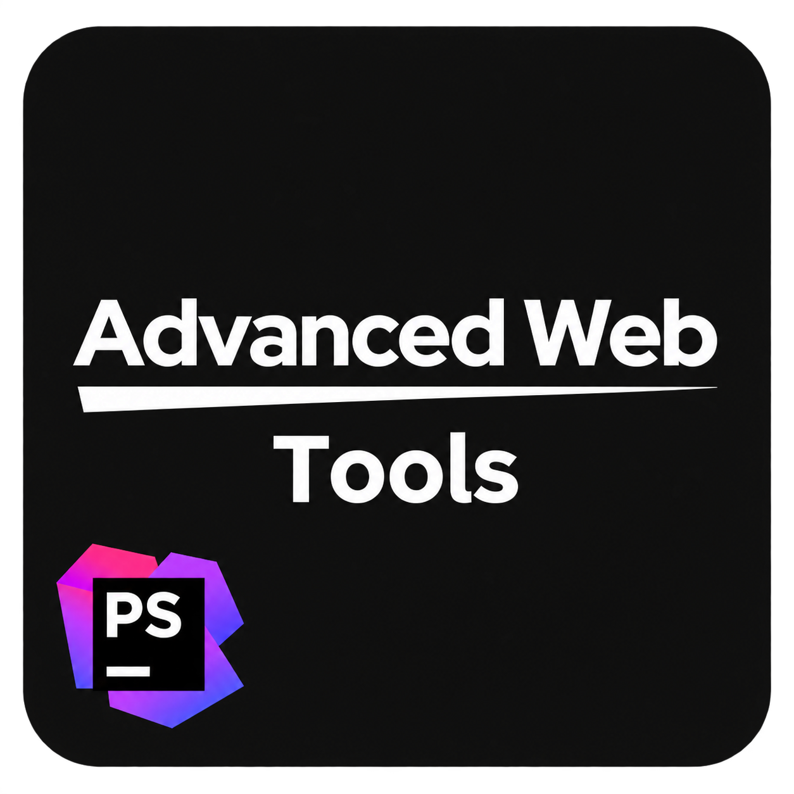

  

# AWT Helper

**Create, build, and deploy AWT packages from PhpStorm.**

AWT Helper brings your AWT development workflow into the IDE you already use. Set up a new package, add your branding, manage dependencies, and deliver changes without switching between tools for every step.

Built for developers creating plugins, themes, and system packages for Advanced Web Tools.

## From idea to package

Start with a guided project setup that brings the essentials together. Enter your package details, choose an AWT installation or download the framework, and get a project ready for development.

Choose icon and preview images directly from your computer. AWT Helper copies them into your package and updates the package details automatically.

Use your configured PhpStorm interpreter, or select a local PHP executable during setup.

## Keep your dependencies within reach

Add dependencies using direct ZIP download links. AWT Helper downloads the packages and makes their code available for completion and navigation in PhpStorm.

Refresh them whenever you need to with **AWT: Reload Dependencies**, available from the Tools menu and the project context menu.

| Platform | Reload dependencies |
| --- | --- |
| Windows / Linux | **Ctrl+Alt+Shift+R** |
| macOS | **Cmd+Option+Shift+R** |

## Build and deploy with confidence

Choose **AWT Build** to prepare a release package, or **AWT Build & Deploy** to build and send it to your running AWT development environment.

Control release names, enable fast builds, and choose whether to install or update your package. After a successful install deployment, AWT Helper automatically switches subsequent deployments to **update**.

Colored console output makes progress and results easier to follow. Project defaults keep your workflow consistent, while individual run configurations let you customize each deployment.

## Preview your work locally

Run your AWT development server directly from PhpStorm. AWT Helper can open your browser when the server is ready, so you can move from editing to previewing with fewer steps.

Work with an existing AWT installation, set up a downloaded framework for local development, or use the framework as a code reference.

## Get started

1. Download the AWT Helper plugin ZIP from the repository’s **Releases** page. Install it through **Settings → Plugins → Install Plugin from Disk**, then restart PhpStorm.
2. Choose **New Project → AWT Package** and follow the setup steps.
3. Add your package details, images, and dependencies, then choose your framework.
4. Develop your package and use **AWT Build** or **AWT Build & Deploy** when you’re ready.

Manage your preferences at any time under **Settings → AWT Helper**.
